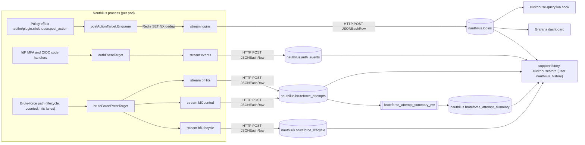

# ClickHouse Data Model Reference

This document is the developer reference for every ClickHouse object Nauthilus
writes or reads: which tables exist, why they exist, which component fills each
column, and how readers query them. Code and DDL are the authority; this
document points at them by file and symbol name.

Related documents:

- DDL: `contrib/clickhouse-kubernetes/schema.sql` (fresh install),
  `contrib/clickhouse-kubernetes/migrations/*.sql` (existing installations),
  `contrib/clickhouse-kubernetes/history-reader.sql` (read-only account).
- Writer contract: `contrib/plugins/clickhouse/DIAGNOSTIC_CONTRACT.md` and
  `contrib/plugins/clickhouse/README.md`.
- Reader: `server/docs/support_authentication_history.md`,
  `server/docs/support_mcp.md`.
- Redis keys used by the ClickHouse plugin: `server/docs/development/redis_keyspace.md`.

## 1. Purpose and Overview

ClickHouse is the only durable history store of Nauthilus. It holds:

- an analytics projection of authentication requests (`nauthilus.logins`);
- purpose-bound step events: second-factor verifications and OIDC
  authorization-code completion (`nauthilus.auth_events`);
- brute-force evidence: ban lifecycle transitions, raw counted, tolerated, and
  ban-hit events, and an hourly aggregate that outlives the raw rows
  (`nauthilus.bruteforce_lifecycle`, `nauthilus.bruteforce_attempts`,
  `nauthilus.bruteforce_attempt_summary`, fed by the materialized view
  `nauthilus.bruteforce_attempt_summary_mv`).

Nauthilus stays fully operable without ClickHouse; only history diagnosis is
then unavailable. The data is not a complete attempt history: deduplication,
buffer limits, process loss, and TTLs remove rows, and a login row exists only
when the selected Policy rule carries the effect
`authn/plugin.clickhouse.post_action`.

### 1.1 Writers

| Writer | Status | Tables | Code |
|---|---|---|---|
| Native Go plugin `clickhouse` (Policy post-action, `AuthEventSink`, `BruteForceEventSink`) | Active | `logins`, `auth_events`, `bruteforce_lifecycle`, `bruteforce_attempts` | `contrib/plugins/clickhouse/*.go` |
| Materialized view `bruteforce_attempt_summary_mv` | Active (server side) | `bruteforce_attempt_summary` | `contrib/clickhouse-kubernetes/schema.sql` |
| Lua action `server/lua-plugins.d/actions/clickhouse.lua` | Unmaintained alternative to the native plugin; configurable as a Lua action again since 4.1.1 | `logins` (legacy column subset only) | `server/lua-plugins.d/actions/clickhouse.lua` |

### 1.2 Readers

| Reader | Tables | Code |
|---|---|---|
| Support history service (HTTP `/api/v1/support/*` and the MCP tools share one instance) | all five tables | `server/supporthistory/clickhousestore/*.go`, consumers in `server/supporthistory/*.go` |
| Grafana dashboard | `logins` | `contrib/clickhouse-kubernetes/nauthilus-logins-grafana-dashboard.json` |
| Lua custom hook (optional operator tool) | `logins` (configurable via `CLICKHOUSE_TABLE`) | `server/lua-plugins.d/hooks/clickhouse-query.lua` |
| Identity-proxy E2E script (test only) | `auth_events` | `contrib/identity-proxy-e2e/scripts/run.sh` |
| Integration tests (test only, build tag `clickhouse_integration`) | all | `contrib/plugins/clickhouse/*_integration_test.go` |

### 1.3 Data Flow

## 2. Object Summary

Database: `nauthilus`.

| Object | Kind | Written by | Read by | Purpose |
|---|---|---|---|---|
| `nauthilus.logins` | `MergeTree`, `ORDER BY (ts)`, TTL 1 week | native login stream; retired Lua action | support history, Grafana, Lua query hook | One row per authentication request whose Policy rule selects the analytics post-action; terminal outcome under contract version 1 |
| `nauthilus.auth_events` | `ReplacingMergeTree`, `ORDER BY (event_type, ts, event_id)`, TTL 1 week | native event stream | support history, E2E script | Second-factor verifications and OIDC code issuance/redemption |
| `nauthilus.bruteforce_lifecycle` | `ReplacingMergeTree`, monthly partitions, TTL 400 days | native `bfLifecycle` stream | support history | Ban activations, unconfirmed activations, releases, counter resets |
| `nauthilus.bruteforce_attempts` | `ReplacingMergeTree`, daily partitions, TTL 14 days, `ttl_only_drop_parts` | native `bfCounted` and `bfHits` streams | support history | Raw counted, tolerated, and ban-hit events |
| `nauthilus.bruteforce_attempt_summary` | `AggregatingMergeTree`, monthly partitions, TTL 400 days | `bruteforce_attempt_summary_mv` | support history | Hourly aggregate that outlives the raw attempt rows |
| `nauthilus.bruteforce_attempt_summary_mv` | Materialized view `TO bruteforce_attempt_summary` | ClickHouse on every insert into `bruteforce_attempts` | not read directly | Feeds the summary table |

Access objects (`history-reader.sql`): settings profile
`nauthilus_history_profile`, user `nauthilus_history`, and five `GRANT SELECT`
statements. There are no roles, row policies, quotas, or column grants (see
section 6).

## 3. Write Path (Native Plugin)

### 3.1 Insert Format

Every stream sends one HTTP `POST` to its configured insert URL. The URL
carries the SQL in its query string, for example
`?query=INSERT INTO nauthilus.logins FORMAT JSONEachRow`. The body is
newline-joined JSON documents (`ndjsonBody`, `postRows` in `post_action.go`).

- Headers: `Accept: */*`, `User-Agent: Nauthilus`, `Content-Type: application/json`.
  HTTP Basic with padded base64 when user and password are both set, otherwise
  `X-ClickHouse-User` / `X-ClickHouse-Key` (`buildHeaders`).
- Success is HTTP 200 or 204.
- The plugin performs no DDL and no schema discovery.
- ClickHouse drops unknown JSONEachRow fields silently unless the insert URL
  appends `&input_format_skip_unknown_fields=0`. Setting it turns schema drift
  into visible insert errors and is the recommended production setting after
  the migrations ran.
- Timestamps are encoded as `2006-01-02 15:04:05.000` UTC text
  (`clickHouseTimestampLayout`, `utcNowMillis` in `row.go`).

### 3.2 Streams

Configuration: `config.go`, stream wiring: `stream.go`, `plugin.go`.

| Stream | Table | Insert URL key | Buffer key (default) | Inline flush | Periodic flush |
|---|---|---|---|---|---|
| `logins` | `logins` | `insert_url` | `cache_key` (`clickhouse:batch:logins`) | In `Enqueue` when the buffer reaches `min(batch_size, max_buffer_rows)` | `flush_interval`, default `0` (disabled) |
| `events` | `auth_events` | `events_insert_url` | `events_cache_key` (`clickhouse:batch:auth_events`) | never | `events_flush_interval`, default 10 s; the worker runs only while the URL is set |
| `bfLifecycle` | `bruteforce_lifecycle` | `bruteforce_lifecycle_insert_url` | `bruteforce_lifecycle_cache_key` (`clickhouse:batch:bruteforce_lifecycle`) | never | `bruteforce_flush_interval`, default 10 s; one worker shared by the three brute-force streams |
| `bfCounted` | `bruteforce_attempts` (kinds `counted`, `threshold_tolerated`) | `bruteforce_attempts_insert_url` | `bruteforce_counted_cache_key` (`clickhouse:batch:bruteforce_counted`) | From the host lane goroutine, bounded by `timeout` and the host delivery deadline | shared brute-force worker |
| `bfHits` | `bruteforce_attempts` (kind `ban_hit`) | `bruteforce_attempts_insert_url` | `bruteforce_hits_cache_key` (`clickhouse:batch:bruteforce_hits`) | same as `bfCounted` | shared brute-force worker |

Buffering rules:

- The buffer keys name entries in the module-scoped host cache
  (`server/pluginruntime/cache.go`). That cache is process-local memory, **not
  Redis**; every pod buffers and flushes its own rows. The keys must be
  distinct (`requireDistinctCacheKeys`).
- Each stream admits at most `max_buffer_rows` rows (default 10000). The limit
  applies per stream, so one process can hold up to five times that amount
  plus in-flight batches.
- On the login stream, rows whose outcome marker is
  `auth.outcome.brute_force_reject` may fill at most
  `max_brute_force_reject_rows` (default `max_buffer_rows / 2`)
  (`reject_share.go`), so a brute-force wave cannot crowd out other rows.
- The inline flush of `logins`, `bfCounted`, and `bfHits` triggers when the
  buffer reaches `min(batch_size, max_buffer_rows)`. A flush pops the whole
  buffer (`PopAll`), not `batch_size` rows.
- A full login buffer drops the new row and triggers a flush attempt.
- With an empty insert URL, `events` and the three brute-force streams drop
  events at admission, while `logins` keeps buffering up to `max_buffer_rows`
  ("insert URL missing; batch kept in cache").
- One insert runs per stream at a time. Failures are requeued within the
  limit and pause that stream with exponential backoff from 1 s to 60 s
  (`stream.go`, `flush_gate.go`). `Stop` flushes every stream once, bounded by
  `timeout`.
- Rows are buffered already encoded, so `event_id` and `ts` stay stable across
  requeues. Ambiguous transport failures can still duplicate rows; there is no
  exactly-once guarantee. Replacing engines and readers handle that (see
  sections 4, 8, and 9).

### 3.3 Login Deduplication

Only the login stream deduplicates (`allowLoginWrite` in `post_action.go`,
`loginDedupKey` in `dedup.go`):

- Enabled per sealed outcome: `ok` uses `dedup_success` (default `true`),
  `fail` uses `dedup_failure` (default `false`); `tempfail` and `unknown` are
  never deduplicated.
- Mechanism: Redis `SET NX EX <auth_dedup_ttl>` (default 300 s) on
  `clickhouse:authdedup:v3:<sha256 hex>`, built through the plugin Redis
  facade (see the Redis reference for the effective key). The digest covers a
  JSON array of username, client IP, protocol, service, method, client IDs,
  SAML entity, grant type, MFA method and completion, authenticated/authorized
  flags, HTTP status, status message, outcome decision, operation, outcome and
  response markers, policy rule, and `flow_ref`. Credentials and password
  hashes are not part of it.
- A missing username or client IP bypasses deduplication. Redis errors fail
  open (the row is written).
- Events and brute-force rows are never deduplicated by the plugin; their
  tables collapse replays by `event_id`.

### 3.4 Skipped Requests

Requests without authentication are skipped, except OIDC token post-actions
(`protocol = oidc`, `service = idp`, non-empty grant type)
(`shouldSkipNoAuth`).

### 3.5 Privacy on the Write Path

| Data | Treatment |
|---|---|
| Password | Never stored. `password_hash` holds the first 8 hex characters of the SHA-256 digest of the nonce-prepared password (`clickHousePasswordHash`; digest from `pluginapi/v1/password`). Requires the plugin capability `CapabilityPasswordHash`. |
| Username, account, display name, client IP, user agent, hostname | Stored in clear text in `logins`. |
| Claimed login names | Stored in clear text only in `bruteforce_attempts.claimed_username`. The summary keeps only `uniq` HLL states. `bruteforce_lifecycle` has no claimed names and no client address. |
| IdP flow handle | Never stored. `flow_ref = hex(sha256("nauthilus.flow_ref.v1\x00" + flow_id))[0:32]`. |
| Rule and bucket identity | `rule_fingerprint` and `bucket_id` are SHA-256 digests computed by the host. |
| Step events | No credentials, OTPs, recovery codes, authorization codes, PKCE verifiers, tokens, cookies, handles, or WebAuthn data. |
| Dedup key | SHA-256 digest only. |
| Logs, metrics, spans | No row bodies, SQL, usernames, client IPs, or credentials; flush errors are logged without error text. |

### 3.6 Lua Action

`server/lua-plugins.d/actions/clickhouse.lua` can be configured as a Lua action
(the 4.0.0 to 4.1.0 releases rejected it), but it receives no new columns; the
native plugin is the maintained writer. It batches through `nauthilus_cache`, flushes only on
size (`CLICKHOUSE_BATCH_SIZE`, default 100), deduplicates only authenticated
rows for a fixed 300 s on the plain key `clickhouse:authdedup:<username>:<client_ip>`,
and sends the legacy column subset: `ts`, `session`, `service`,
`decision_sources`, columns `client_ip` through `geoip_asn_status`, and
`repeating` through `status_msg` (53 columns of the current schema), plus the
retired `gp_*`, `prot_*`, and `dyn_*` columns (but no `reputation_*`
columns). Because of those retired columns, tables created from the current
`schema.sql`, or after the retirement block ran, reject its rows when the
insert URL sets `input_format_skip_unknown_fields=0`. It never writes
`deployment`, so the support history service never sees its rows, and
`contract_version` stays at the column default `0`.

## 4. Tables

"Source" names the field of the native writer struct and where its value comes
from. All `logins` fields live in `clickHouseRow` (`row.go`), built by
`buildRow`, `applyContractInfo`, `applyTerminalOutcome` (`outcome_row.go`), and
`applyReputationAssessments` (`reputation_row.go`).

### 4.1 `nauthilus.logins`

- Purpose: one projection row per authentication request.
- Engine: `MergeTree`; `ORDER BY (ts)` (also the primary key); no partitioning;
  `TTL ts + INTERVAL 1 WEEK DELETE`; `index_granularity = 8192`.
- Skip indexes: `idx_flow_ref` (`flow_ref`, `bloom_filter`, granularity 64);
  `idx_username`, `idx_account`, `idx_client_ip` (`tokenbf_v1(1024, 3, 0)`,
  granularity 64).
- No replacing semantics: replays stay as duplicate rows that share
  `event_id`.
- Row timing: the request snapshot is captured when the selected rule's
  effects are prepared. `http_status`, `status_msg`, and the outcome columns
  are late-bound from the sealed terminal outcome when the post-action runs
  after the response commit.
- Effective columns: 89. The native writer fills every one of them.

| # | Column | Type | Default / codec | Source (native writer) | Meaning |
|---|---|---|---|---|---|
| 1 | `ts` | `DateTime64(3, 'UTC')` | - | `TS` = `utcNowMillis()` at encode time | Enqueue time after the response commit (UTC, ms). Primary key. |
| 2 | `session` | `String` | - | `Session` <- `Snapshot.Session` | Per-request correlation ID (`Runtime.GUID`). Joins `auth_events.request_id` and `bruteforce_*.request_id` of the same request. Not a flow ID. |
| 3 | `service` | `LowCardinality(String)` | `ZSTD(3)` | `Service` <- `Snapshot.Service` | Auth endpoint service (for example `idp`). |
| 4 | `deployment` | `LowCardinality(String)` | `DEFAULT ''`, `ZSTD(3)` (tables migrated from the legacy shape have no default) | `Deployment` <- module config `deployment` | Writer separation. The support history reader binds every query to it. |
| 5 | `instance` | `LowCardinality(String)` | `DEFAULT ''`, `ZSTD(3)` (no default on migrated tables) | `Instance` <- module config `instance` | Writer instance (pod) label. |
| 6 | `decision_sources` | `LowCardinality(String)` | `ZSTD(3)` | `DecisionSources` <- `Snapshot.DecisionSourcesString()` | Comma list of controls that fired (`tls_encryption`, `relay_domains`, `rbl`, `brute_force`, `blocklist`, `failed_login_hotspot`, ...); empty when none fired. Query by membership, not by exact string. |
| 7 | `rbl_lists` | `Array(LowCardinality(String))` | - | `RBLLists` <- `Diagnostics.RBLMatchedLists` (nil becomes `[]`) | Every configured RBL list that listed the client IP, including matches below the threshold. |
| 8 | `client_ip` | `String` | - | `ClientIP` <- `Snapshot.ClientIP` | Client address as supplied. |
| 9 | `client_port` | `String` | - | `ClientPort` | Client port. |
| 10 | `client_net` | `LowCardinality(String)` | - | `ClientNet` | Brute-force client network chosen by the brute-force path; empty when brute force did not run. |
| 11 | `client_id` | `LowCardinality(String)` | - | `ClientID` | Caller-supplied client ID (`X-Client-ID`). |
| 12 | `hostname` | `LowCardinality(String)` | `ZSTD(3)` | `Hostname` <- `Snapshot.ClientHost` | Client host name (caller-supplied or reverse DNS). |
| 13 | `proto` | `LowCardinality(String)` | - | `Proto` <- `Snapshot.Protocol` | Protocol (`imap`, `smtp`, `oidc`, ...). |
| 14 | `method` | `LowCardinality(String)` | - | `Method` | Authentication method. |
| 15 | `user_agent` | `LowCardinality(String)` | `ZSTD(5)` | `UserAgent` | Client user agent. |
| 16 | `local_ip` | `LowCardinality(String)` | - | `LocalIP` | Local (server) address. |
| 17 | `local_port` | `String` | - | `LocalPort` | Local port. |
| 18 | `display_name` | `LowCardinality(String)` | - | `DisplayName` | Resolved display name; empty for unknown users. |
| 19 | `account` | `LowCardinality(String)` | - | `Account` | Resolved account; empty when unknown or not yet looked up at capture time. |
| 20 | `username` | `LowCardinality(String)` | - | `Username` | Login name as sent (a claim). |
| 21 | `password_hash` | `String` | - | `PasswordHash` <- `clickHousePasswordHash(...)` | 8-hex prefix of the nonce-prepared SHA-256 password digest; empty without a password. History APIs must not expose it. |
| 22 | `pwnd_info` | `LowCardinality(String)` | - | `PwndInfo` <- exchange `HIBPHashInfo()` | Have-I-Been-Pwned prefix and count; empty when HIBP did not run before this post-action. |
| 23 | `brute_force_bucket` | `LowCardinality(String)` | - | `BruteForceBucket` <- `Diagnostics.BruteForceName` | Bucket that went over its limit; also set when toleration suppressed the block. |
| 24 | `brute_force_counter` | `Nullable(UInt64)` | - | `BruteForceCounter` <- `Diagnostics.BruteForceCounter` | Bucket counter at capture time; `0` when no bucket. The native writer never writes NULL. |
| 25 | `oidc_cid` | `LowCardinality(String)` | - | `OIDCCID` | OIDC client ID (IdP context). |
| 26 | `saml_entity_id` | `LowCardinality(String)` | - | `SAMLEntityID` | SAML relying-party entity ID. |
| 27 | `grant_type` | `LowCardinality(String)` | - | `GrantType` <- `Snapshot.IDP.GrantType` | OIDC grant type. |
| 28 | `mfa_method` | `LowCardinality(String)` | - | `MFAMethod` <- `Snapshot.IDP.MFAMethod` | Second factor completed for this request; empty for password logins. MFA history lives in `auth_events`. |
| 29 | `failed_login_count` | `Nullable(UInt64)` | - | `FailedLoginCount` <- exchange `failed_login_hotspot.count` or `.new_count` (`applyFailedLoginInfo`) | Failed-login hotspot count; NULL without a producer. |
| 30 | `failed_login_rank` | `Nullable(UInt64)` | - | `FailedLoginRank` <- `.rank` | Hotspot rank. |
| 31 | `failed_login_recognized` | `Nullable(Bool)` | - | `FailedLoginRecognized` <- `.recognized_account` | The hotspot recognized the account. |
| 32 | `geoip_guid` | `LowCardinality(String)` | - | `GeoIPGUID` <- GeoIP field `guid` (`applyGeoIPInfo`) | Legacy exchange GUID; no active producer. |
| 33 | `geoip_country` | `LowCardinality(String)` | - | `GeoIPCountry` <- `country_iso` or `current_country_code`, normalized to ISO alpha-2 | Country of the client IP. |
| 34 | `geoip_iso_codes` | `LowCardinality(String)` | - | `GeoIPISOCodes` <- `iso_codes_seen` plus the country, comma-joined | Distinct ISO codes seen. |
| 35 | `geoip_status` | `LowCardinality(String)` | - | `GeoIPStatus` <- `status`, else `matched` / `miss` (`geoIPStatus`) | GeoIP lookup status. |
| 36 | `geoip_source` | `LowCardinality(String)` | - | `GeoIPSource` <- `source`, else `native_geoip` | GeoIP evidence source. |
| 37 | `geoip_matched` | `Nullable(Bool)` | - | `GeoIPMatched` <- `matched` | The lookup matched. |
| 38 | `geoip_country_name` | `LowCardinality(String)` | - | `GeoIPCountryName` | Country name. |
| 39 | `geoip_city_name` | `LowCardinality(String)` | - | `GeoIPCityName` | City name (empty with a country-only database). |
| 40 | `geoip_asn` | `Nullable(UInt64)` | - | `GeoIPASN` | Autonomous system number. |
| 41 | `geoip_asn_org` | `LowCardinality(String)` | - | `GeoIPASNOrg` | AS organisation. |
| 42 | `geoip_asn_prefix` | `LowCardinality(String)` | - | `GeoIPASNPrefix` | Announced prefix. |
| 43 | `geoip_asn_registry` | `LowCardinality(String)` | - | `GeoIPASNRegistry` | Regional internet registry of the AS. |
| 44 | `geoip_asn_country` | `LowCardinality(String)` | - | `GeoIPASNCountry` <- `asn_country_iso` | AS country (ISO). |
| 45 | `geoip_asn_allocated` | `LowCardinality(String)` | - | `GeoIPASNAllocated` | AS allocation date. |
| 46 | `geoip_asn_status` | `LowCardinality(String)` | - | `GeoIPASNStatus` | AS status. |
| 47 | `geoip_privacy_lookup_state` | `LowCardinality(String)` | - | `GeoIPPrivacyLookupState` <- `GeoIPAnalytics.Privacy.LookupState` (`applyGeoIPPrivacyInfo`) | Privacy-intelligence lookup state. |
| 48 | `geoip_privacy_detected` | `Nullable(Bool)` | - | `GeoIPPrivacyDetected` | Any privacy class detected; NULL without evidence. |
| 49 | `geoip_privacy_classes` | `Array(String)` | - | `GeoIPPrivacyClasses` (always an array) | Detected privacy classes; `[]` when none. |
| 50 | `geoip_privacy_primary_class` | `LowCardinality(String)` | - | `GeoIPPrivacyPrimaryClass` | Primary privacy class. |
| 51 | `geoip_privacy_confidence` | `Nullable(Float64)` | - | `GeoIPPrivacyConfidence` | Classification confidence. |
| 52 | `geoip_privacy_source_authorities` | `Array(String)` | - | `GeoIPPrivacySourceAuthorities` (always an array) | Evidence authorities; `[]` when none. |
| 53 | `geoip_privacy_data_stale` | `Nullable(Bool)` | - | `GeoIPPrivacyDataStale` | The evidence data is stale. |
| 54 | `geoip_privacy_data_age_seconds` | `Nullable(UInt64)` | - | `GeoIPPrivacyDataAgeSeconds` | Evidence age in seconds. |
| 55 | `geoip_is_tor_exit_node` | `Nullable(Bool)` | - | `GeoIPIsTorExitNode` | Tor exit evidence. |
| 56 | `geoip_is_known_vpn_exit` | `Nullable(Bool)` | - | `GeoIPIsKnownVPNExit` | Known VPN exit evidence. |
| 57 | `geoip_is_community_vpn_exit` | `Nullable(Bool)` | - | `GeoIPIsCommunityVPNExit` | Community VPN exit evidence. |
| 58 | `geoip_is_public_proxy` | `Nullable(Bool)` | - | `GeoIPIsPublicProxy` | Public proxy evidence. |
| 59 | `geoip_is_privacy_relay` | `Nullable(Bool)` | - | `GeoIPIsPrivacyRelay` | Privacy relay evidence. |
| 60 | `geoip_is_hosting_network` | `Nullable(Bool)` | - | `GeoIPIsHostingNetwork` | Hosting network evidence (separate from VPN). |
| 61 | `geoip_is_shared_egress` | `Nullable(Bool)` | - | `GeoIPIsSharedEgress` | Shared egress evidence; intended for custom queries. |
| 62 | `repeating` | `Nullable(Bool)` | - | `Repeating` <- `Snapshot.Runtime.Repeating` | Brute-force repeat hint; `false` when brute force did not run. Weak, capture-time signal. |
| 63 | `rwp` | `Nullable(Bool)` | - | `RWP` | Repeated-wrong-password hint. Weak, capture-time signal. |
| 64 | `user_found` | `Nullable(Bool)` | - | `UserFound` | Account resolved at capture time; also `false` when the lookup had not run yet. |
| 65 | `authenticated` | `Nullable(Bool)` | - | `Authenticated` | `Runtime.Authenticated` at capture; `false` for fail and tempfail. Superseded by `outcome` as the outcome carrier. |
| 66 | `xssl_protocol` | `LowCardinality(String)` | - | `XSSLProtocol` <- `TLS.Legacy.Protocol` | TLS protocol reported by the proxy. |
| 67 | `xssl_cipher` | `LowCardinality(String)` | - | `XSSLCipher` <- `TLS.Legacy.CipherSuite` | TLS cipher reported by the proxy. |
| 68 | `ssl_fingerprint` | `LowCardinality(String)` | - | `SSLFingerprint` <- `TLS.Legacy.Fingerprint` | Client TLS fingerprint header. |
| 69 | `latency` | `UInt64` | - | `Latency` <- `Diagnostics.LatencyMillis` (negative becomes 0) | Milliseconds from request start to capture; `0` when unknown. |
| 70 | `http_status` | `UInt16` | - | `HTTPStatus` <- `Diagnostics.HTTPStatus`, refreshed from the sealed outcome | Host status code configured for the terminal decision; `0` when the outcome is unknown. |
| 71 | `status_msg` | `LowCardinality(String)` | - | `StatusMessage` <- `Diagnostics.StatusMessage` (late-bound) | Final client status text; empty when the outcome is unknown. |
| 72 | `contract_version` | `UInt16` | `DEFAULT 0` | `ContractVersion` = `loginContractVersion` (1) | `0` legacy row, `1` diagnostic data contract. |
| 73 | `event_id` | `String` | `DEFAULT ''` | `EventID` <- `newEventID()` (128-bit random hex) | Row identity; stable across requeues; identifies duplicates. |
| 74 | `operation` | `LowCardinality(String)` | `DEFAULT ''` | `Operation` <- `Outcome.Operation` | Policy operation: `authenticate`, `lookup_identity`, `list_accounts`; empty when unknown. |
| 75 | `outcome` | `LowCardinality(String)` | `DEFAULT ''` | `Outcome` <- `Outcome.Decision`, or `unknown` when unsealed | `ok`, `fail`, `tempfail`, `unknown`; empty for legacy rows. |
| 76 | `outcome_stage` | `LowCardinality(String)` | `DEFAULT ''` | `OutcomeStage` | Policy stage of the presenting rule (`pre_auth`, `auth_decision`, ...). |
| 77 | `outcome_marker` | `LowCardinality(String)` | `DEFAULT ''` | `OutcomeMarker` | Policy outcome marker (for example `auth.outcome.auth_failure`, `auth.outcome.brute_force_reject`). |
| 78 | `response_marker` | `LowCardinality(String)` | `DEFAULT ''` | `ResponseMarker` | Response marker (for example `auth.response.tempfail.no_tls`). |
| 79 | `policy_rule` | `LowCardinality(String)` | `DEFAULT ''` | `PolicyRule` | Name of the presenting rule. |
| 80 | `tempfail_reason` | `LowCardinality(String)` | `DEFAULT ''` | `TempFailReason` | `policy_indeterminate`, `backend_tempfail`, `auth_fsm_guard`, `brute_force_error`, `environment_tempfail`; empty unless tempfail. |
| 81 | `tempfail_checkpoint` | `LowCardinality(String)` | `DEFAULT ''` | `TempFailCheckpoint` | Checkpoint where an indeterminate result surfaced. |
| 82 | `policy_status` | `LowCardinality(String)` | `DEFAULT ''` | `PolicyStatus` | Decision status code (`evaluation_failed`, `provider_unavailable`, ...). |
| 83 | `fsm_state` | `LowCardinality(String)` | `DEFAULT ''` | `FSMState` | Terminal auth FSM state. |
| 84 | `transport` | `LowCardinality(String)` | `DEFAULT ''` | `Transport` <- `Outcome.Transport` | `http`, `grpc`, or empty when unknown. |
| 85 | `transport_status` | `Nullable(UInt16)` | - | `TransportStatus`, only for `http` and values above 0 | Committed HTTP writer status; NULL for gRPC or unknown. Never derive the result from it. |
| 86 | `flow_ref` | `String` | `DEFAULT ''` | `FlowRef` <- `Snapshot.IDP.FlowRef` | Non-authorizing IdP flow digest (32 hex); joins `auth_events.flow_ref`; empty outside IdP browser flows. |
| 87 | `brute_force_tolerated` | `Nullable(Bool)` | - | `BruteForceTolerated` <- `Diagnostics.BruteForceTolerated`, only when a bucket name is set | `true` when toleration suppressed a triggered bucket; NULL without a bucket. |
| 88 | `reputation_assessments` | `Array(Tuple(...))`, see below | empty array | `ReputationAssessments` (`[]reputationAssessmentRow`) <- record facts decoded by `reputationview` | One tuple per (fact, subject record); measured fields are NULL for `not_found` / `unavailable`; at most 64 tuples. |
| 89 | `reputation_truncated` | `Bool` | `DEFAULT false` | `ReputationTruncated` <- `request.FactsTrimmed`, or a record beyond the 64-tuple cap was dropped | The host or the plugin dropped assessment records to stay within bounds. Exactly 64 tuples alone do not set it. |

`reputation_assessments` tuple elements (`reputationAssessmentRow`):

| Element | Type | Value domain |
|---|---|---|
| `fact`, `role`, `profile` | `LowCardinality(String)` | Policy fact name, subject role, reputation profile |
| `kind` | `LowCardinality(String)` | `ip`, `network`, `asn`, `dns_domain`, `account`, `service` |
| `state` | `LowCardinality(String)` | `fresh`, `stale`, `not_found`, `unavailable` |
| `band` | `LowCardinality(String)` | `unknown`, `trusted`, `positive`, `neutral`, `suspicious`, `blocked`, `unavailable` |
| `override` | `LowCardinality(String)` | `none`, `trusted`, `neutral`, `blocked` |
| `risk_score`, `trust_score`, `confidence`, `samples` | `Nullable(Float64)` | Measured values |
| `source_diversity`, `age_seconds` | `Nullable(Int64)` | Measured values |

#### Retired Columns of `logins`

These columns are not part of the current schema. Tables in the legacy shape
carry them until the separately approved `retire-legacy-columns` block at the
end of `schema.sql` drops them. Types are
taken from `contrib/plugins/clickhouse/testdata/diagnostic_contract/legacy_logins_schema.sql`,
except for `features`, which predates that fixture.
The native plugin never writes them (pinned by `retired_columns_test.go`).

| Column | Legacy type | Writer | Replaced by |
|---|---|---|---|
| `reputation_score`, `reputation_positive_score`, `reputation_negative_score`, `reputation_ip_score`, `reputation_asn_score`, `reputation_country_score`, `reputation_asn_country_score` | `Nullable(Float64)` | none | `reputation_assessments` |
| `reputation_samples` | `Nullable(UInt64)` | none | `reputation_assessments` |
| `reputation_source`, `reputation_decision` | `LowCardinality(String)` | none | `reputation_assessments` |
| `gp_attempts`, `gp_unique_ips`, `gp_unique_users` | `Nullable(UInt64)` | retired Lua action | - (global pattern map) |
| `gp_ips_per_user` | `Nullable(Float64)` | retired Lua action | - |
| `prot_active` | `Nullable(Bool)` | retired Lua action | - (account protection map) |
| `prot_reason` | `LowCardinality(String)` | retired Lua action | - |
| `prot_backoff`, `prot_delay_ms` | `Nullable(UInt64)` | retired Lua action | - |
| `dyn_threat` | `Nullable(UInt64)` | retired Lua action | - (dynamic response map) |
| `dyn_response` | `LowCardinality(String)` | retired Lua action | - |
| `features` | historical (not in the fixture) | none | `decision_sources`; mentioned only in a `schema.sql` comment, the retirement block does not drop it |

Column arithmetic: the legacy table has 91 columns, the diagnostic-contract
migration adds 18, and the retirement block removes 20, which yields the 89
columns of a fresh table.

### 4.2 `nauthilus.auth_events`

- Purpose: host-observed step events that are not authentication requests:
  `mfa.verification`, `oidc.code_issuance`, `oidc.code_redemption`
  (`pluginapi/v1/auth_event.go`). Never a copy of login rows.
- DDL: `schema.sql`, identical to `migrations/diagnostic-contract.sql`.
- Engine: `ReplacingMergeTree` without a version column;
  `ORDER BY (event_type, ts, event_id)`; no partitioning;
  `TTL toDateTime(ts) + INTERVAL 1 WEEK DELETE`.
- Skip indexes: `idx_events_flow_ref` (`flow_ref`, `bloom_filter`, 64);
  `idx_events_account` (`account`, `tokenbf_v1(1024, 3, 0)`, 64).
- Replays of one `event_id` collapse at merge time. Until then they are
  visible; the support history collapses them in Go (`dedupeByID`).
- Writer: `authEventRow`, filled in one literal by `newAuthEventRow`
  (`event_sink.go`) from `pluginapi.AuthEvent`. 19 columns.

| # | Column | Type | Source | Meaning |
|---|---|---|---|---|
| 1 | `ts` | `DateTime64(3, 'UTC')` | `ObservedAt` (UTC ms) | Host observation time. |
| 2 | `event_id` | `String` | `EventID` | Host-generated random 128-bit hex; idempotency key. |
| 3 | `event_type` | `LowCardinality(String)` | `Type` | `mfa.verification`, `oidc.code_issuance`, `oidc.code_redemption`. |
| 4 | `event_version` | `UInt16` | `Version` | `1` for all three types; issuance version 1 fixes a 10-minute redemption bound. |
| 5 | `deployment` | `LowCardinality(String)` | module config | Writer separation. |
| 6 | `instance` | `LowCardinality(String)` | module config | Writer instance. |
| 7 | `request_id` | `String` | `RequestID` | `Runtime.GUID` of the observing request; joins `logins.session` for the same request only. |
| 8 | `flow_ref` | `String` | `FlowRef` | Flow digest; joins `logins.flow_ref`; empty for self-service step-ups. |
| 9 | `protocol` | `LowCardinality(String)` | `Protocol` | `oidc`, `saml`, or `account` (self-service). |
| 10 | `client_id` | `LowCardinality(String)` | `ClientID` | OIDC relying party. |
| 11 | `saml_entity_id` | `LowCardinality(String)` | `SAMLEntityID` | SAML relying party. |
| 12 | `account` | `LowCardinality(String)` | `Account` | Pending or authenticated identity account. |
| 13 | `client_ip` | `String` | `ClientIP` | Browser address; empty on `oidc.code_redemption` (the requester is the relying-party backend). |
| 14 | `factor_role` | `LowCardinality(String)` | `FactorRole` | `second_factor` for MFA; empty for completion events (`primary` is reserved and never written). |
| 15 | `method` | `LowCardinality(String)` | `Method` | `totp`, `recovery_codes`, `webauthn`; empty for completion events. |
| 16 | `result` | `LowCardinality(String)` | `Result` | `success`, `invalid`, `error`, `rate_limited`, `rejected`. |
| 17 | `reason` | `LowCardinality(String)` | `Reason` | Stable reason code (issuance: `authenticated_in_flow`, `existing_session`, `not_recorded`; redemption: `tokens_issued`, `client_mismatch`, ...). |
| 18 | `flow_effect` | `LowCardinality(String)` | `FlowEffect` | `none`, `step_up_completed`, `primary_failure_kept`, `code_issued`, `tokens_issued`, `code_consumed`. |
| 19 | `fail_latched` | `Bool` | `FailLatched` | The primary step had already failed, so a correct factor does not authenticate. Operator-only meaning together with `result = 'success'`. |

### 4.3 `nauthilus.bruteforce_lifecycle`

- Purpose: rare ban lifecycle transitions with long retention for ban
  explanations. No claimed names and no client address.
- DDL: `schema.sql`, identical to `migrations/bruteforce-evidence.sql`.
- Engine: `ReplacingMergeTree`; `PARTITION BY toYYYYMM(ts)`;
  `ORDER BY (deployment, network, ts, kind, event_id)`;
  `TTL toDateTime(ts) + INTERVAL 400 DAY DELETE`.
- Skip index: `idx_bfl_bucket` (`bucket_id`, `bloom_filter`, granularity 4).
- Kinds: `ban_activated`, `ban_activation_unconfirmed`, `ban_released`,
  `counters_reset` (`pluginapi/v1/bruteforce_event.go`).
- Writer: `bruteForceLifecycleRow` = the shared `bruteForceEventRow` (21
  fields) plus 6 lifecycle fields, encoded by `encodeBruteForceRow`
  (`bruteforce_sink.go`) from `pluginapi.BruteForceEvent`. 27 columns.

| # | Column | Type | Source | Meaning |
|---|---|---|---|---|
| 1 | `ts` | `DateTime64(3, 'UTC')` | `ObservedAt` (UTC ms) | Host observation time. |
| 2 | `event_id` | `String` | `EventID` | Event identity; on `ban_activated` it is the `ban_ref` of the ban instance. |
| 3 | `event_version` | `UInt16` | `Version` | `1`. |
| 4 | `kind` | `LowCardinality(String)` | `Kind` | Lifecycle kind (see above). |
| 5 | `deployment` | `LowCardinality(String)` | module config | Writer separation; sort-key prefix. |
| 6 | `instance` | `LowCardinality(String)` | module config | Writer instance. |
| 7 | `request_id` | `String` | `RequestID` | Join key to attempt rows and the login row of the activating request (never "the culprit"). |
| 8 | `network` | `String` | `Network` | Banned network (CIDR text); the ban key. |
| 9 | `ip_family` | `UInt8` | `IPFamily` | `4` or `6`. |
| 10 | `cidr` | `UInt8` | `CIDR` | Prefix length of the rule. |
| 11 | `rule` | `LowCardinality(String)` | `Rule` | Rule name. On wildcard `ban_released` rows it is the first configured rule sharing the ban key (not authoritative). |
| 12 | `rule_fingerprint` | `LowCardinality(String)` | `RuleFingerprint` | SHA-256 over rule name, period, cidr, failed_requests, IP families, sorted filters, and effective ban time. |
| 13 | `stored_rule` | `LowCardinality(String)` | `StoredRule` | Rule value stored in the Redis ban key (lifecycle rows only). |
| 14 | `bucket_id` | `String` | `BucketID` | SHA-256 of the window-less Redis bucket key of the activating rule. |
| 15 | `period_seconds` | `Int64` | `PeriodSeconds` | Rule period. |
| 16 | `ban_time_seconds` | `Int64` | `BanTimeSeconds` | Effective ban time. |
| 17 | `failed_requests` | `Int64` | `FailedRequests` | Rule threshold parameter. |
| 18 | `window_index` | `Nullable(Int64)` | `WindowIndex` | Epoch-aligned window number of the activating pre-check. |
| 19 | `window_current` | `Nullable(Int64)` | `Current` | Pre-check counter of the current window; `1..window_current` is the closed set of counted increments. |
| 20 | `window_previous` | `Nullable(Int64)` | `Previous` | Pre-check counter of the previous window. |
| 21 | `total` | `Nullable(Float64)` | `Total` | `current + previous * weight` at the pre-check. |
| 22 | `effective_limit` | `Nullable(Float64)` | `Limit` | `failed_requests - 1`, scaled by positive reputation. |
| 23 | `expires_at` | `Nullable(DateTime64(3, 'UTC'))` | `ExpiresAt` | Planned ban end. |
| 24 | `release_source` | `LowCardinality(String)` | `ReleaseSource` | `admin_flush`, `user_flush`. |
| 25 | `operator_client_id` | `LowCardinality(String)` | `OperatorClientID` | Operator reference of a release (detail projection only). |
| 26 | `operator_auth_method` | `LowCardinality(String)` | `OperatorAuthMethod` | Operator authentication method. |
| 27 | `keys_removed` | `Nullable(Int64)` | `KeysRemoved` | Redis keys whose removal Redis confirmed (release or reset). |

### 4.4 `nauthilus.bruteforce_attempts`

- Purpose: raw counted, tolerated, and ban-hit events with short retention.
  Daily partitions expire whole.
- DDL: `schema.sql`, identical to `migrations/bruteforce-evidence.sql`.
- Engine: `ReplacingMergeTree`; `PARTITION BY toDate(ts)`;
  `ORDER BY (deployment, network, bucket_id, ts, event_id)`;
  `TTL toDate(ts) + INTERVAL 14 DAY DELETE`;
  `SETTINGS index_granularity = 8192, ttl_only_drop_parts = 1`.
- Skip indexes: `idx_bfa_client_ip` (`client_ip`, `bloom_filter`, 4);
  `idx_bfa_request` (`request_id`, `bloom_filter`, 4).
- Kinds: `counted` and `threshold_tolerated` (stream `bfCounted`), `ban_hit`
  (stream `bfHits`) (`bruteForceStreamFor`).
- Writer: `bruteForceAttemptRow` = the shared 21 fields plus 13 volume fields
  (`bruteforce_sink.go`). 34 columns.

| # | Column | Type | Source | Meaning |
|---|---|---|---|---|
| 1 | `ts` | `DateTime64(3, 'UTC')` | `ObservedAt` | Host observation time. |
| 2 | `event_id` | `String` | `EventID` | Event identity; replays share it. |
| 3 | `event_version` | `UInt16` | `Version` | `1`. |
| 4 | `kind` | `LowCardinality(String)` | `Kind` | `counted`, `threshold_tolerated`, `ban_hit`. |
| 5 | `deployment` | `LowCardinality(String)` | module config | Writer separation; sort-key prefix. |
| 6 | `instance` | `LowCardinality(String)` | module config | Writer instance. |
| 7 | `request_id` | `String` | `RequestID` | Request GUID; joins `logins.session`. |
| 8 | `client_ip` | `String` | `ClientIP` | Client address (volume lanes only). |
| 9 | `network` | `String` | `Network` | Bucket network. |
| 10 | `ip_family` | `UInt8` | `IPFamily` | `4` or `6`. |
| 11 | `cidr` | `UInt8` | `CIDR` | Prefix length. |
| 12 | `rule` | `LowCardinality(String)` | `Rule` | Rule; on hits the first matching candidate rule, which can differ from the activating rule. |
| 13 | `rule_fingerprint` | `LowCardinality(String)` | `RuleFingerprint` | See 4.3. |
| 14 | `bucket_id` | `String` | `BucketID` | SHA-256 of the window-less bucket key; sort-key part. |
| 15 | `bucket_protocol` | `LowCardinality(String)` | `BucketProtocol` | Protocol scope of the bucket when the rule filters on it. |
| 16 | `bucket_oidc_client` | `LowCardinality(String)` | `BucketOIDCClient` | OIDC client scope of the bucket. |
| 17 | `period_seconds` | `Int64` | `PeriodSeconds` | Rule period. |
| 18 | `ban_time_seconds` | `Int64` | `BanTimeSeconds` | Effective ban time. |
| 19 | `failed_requests` | `Int64` | `FailedRequests` | Rule threshold parameter. |
| 20 | `window_index` | `Nullable(Int64)` | `WindowIndex` | Window of the increment; NULL when the pre-check did not read counters (for example an existing ban). |
| 21 | `weight` | `Nullable(Float64)` | `Weight` | `1 - (now % period) / period`. |
| 22 | `window_current` | `Nullable(Int64)` | `Current` | Counter after this increment; grows by one per counted increment of a bucket window. |
| 23 | `window_previous` | `Nullable(Int64)` | `Previous` | Previous-window counter. |
| 24 | `total` | `Nullable(Float64)` | `Total` | Weighted total. |
| 25 | `effective_limit` | `Nullable(Float64)` | `Limit` | Effective limit. |
| 26 | `crossed` | `Nullable(Bool)` | `Crossed` | `total - 1 <= effective_limit < total` for this increment (heuristic). |
| 27 | `count_source` | `LowCardinality(String)` | `CountSource` | `backend_failure`, `pre_auth_reject`, `protected_endpoint`, `policy_update:<feature>`. |
| 28 | `ban_active` | `Nullable(Bool)` | `BanActive` | The request itself hit an existing ban; NULL when not checked. |
| 29 | `claimed_username` | `String` | `ClaimedUsername` | Login name as entered; a claim that can contain secrets typed by users. |
| 30 | `account` | `String` | `Account` | Account from a consulted mapping. |
| 31 | `account_known` | `Nullable(Bool)` | `AccountKnown` | Tri-state; NULL when no mapping was consulted. |
| 32 | `protocol` | `LowCardinality(String)` | `Protocol` | Request protocol. |
| 33 | `oidc_client_id` | `LowCardinality(String)` | `OIDCClientID` | Request OIDC client. |
| 34 | `hit_source` | `LowCardinality(String)` | `HitSource` | `redis`, `l1`, `activation_race` (`ban_hit` only). |

### 4.5 `nauthilus.bruteforce_attempt_summary`

- Purpose: hourly aggregate of attempts that outlives the 14-day raw rows.
  Distinct names are kept as HLL states only.
- DDL: `schema.sql`, identical to `migrations/bruteforce-evidence.sql`.
- Engine: `AggregatingMergeTree`; `PARTITION BY toYYYYMM(hour)`;
  `ORDER BY (deployment, network, bucket_id, kind, window_index, hour, rule)`;
  `TTL hour + INTERVAL 400 DAY DELETE`. No skip indexes.
- Written only by `bruteforce_attempt_summary_mv`. 15 columns.

| # | Column | Type | MV expression | Meaning |
|---|---|---|---|---|
| 1 | `hour` | `DateTime('UTC')` | `toStartOfHour(ts)` | Hour bucket. |
| 2 | `deployment` | `LowCardinality(String)` | `deployment` | Writer separation. |
| 3 | `network` | `String` | `network` | Bucket network. |
| 4 | `bucket_id` | `String` | `bucket_id` | Bucket. |
| 5 | `kind` | `LowCardinality(String)` | `kind` | Volume kind. |
| 6 | `rule` | `LowCardinality(String)` | `rule` | Rule. |
| 7 | `window_index` | `Int64` | `ifNull(window_index, -1)` | Window; `-1` when the raw row had none. |
| 8 | `events` | `SimpleAggregateFunction(sum, UInt64)` | `count()` | Row count (upper bound under replay). |
| 9 | `ban_active_events` | `SimpleAggregateFunction(sum, UInt64)` | `countIf(ban_active = true)` | Rows that hit an active ban. |
| 10 | `min_current` | `SimpleAggregateFunction(min, Nullable(Int64))` | `min(window_current)` | Lowest counter (exact under replay). |
| 11 | `max_current` | `SimpleAggregateFunction(max, Nullable(Int64))` | `max(window_current)` | Highest counter (exact under replay). |
| 12 | `first_ts` | `SimpleAggregateFunction(min, DateTime64(3, 'UTC'))` | `min(ts)` | First event in the hour. |
| 13 | `last_ts` | `SimpleAggregateFunction(max, DateTime64(3, 'UTC'))` | `max(ts)` | Last event in the hour. |
| 14 | `claimed_names` | `AggregateFunction(uniq, String)` | `uniqStateIf(claimed_username, claimed_username != '')` | Distinct claimed names (HLL state; hashed, but still testable for a given name). |
| 15 | `accounts` | `AggregateFunction(uniq, String)` | `uniqStateIf(account, account != '')` | Distinct accounts (HLL state). |

The in-repository readers use only `events`, `min_current`, `max_current`, and
`claimed_names`; `ban_active_events`, `first_ts`, `last_ts`, and `accounts` are
written by the view for custom queries; no in-repository reader uses them.

## 5. Materialized View

`nauthilus.bruteforce_attempt_summary_mv`:

- Source: every insert block into `nauthilus.bruteforce_attempts` (all kinds).
  There is no `POPULATE`; rows inserted before the view existed are not
  aggregated. Both objects are created by the same file.
- Target: `TO nauthilus.bruteforce_attempt_summary`.
- Aggregation: `GROUP BY hour, deployment, network, bucket_id, kind, rule, window_index`
  with `hour = toStartOfHour(ts)` and `window_index = ifNull(window_index, -1)`.
  The group key equals the target sort key, so background merges fold partial
  blocks.
- Readers must finalize the states: `sum(events)`, `min(min_current)`,
  `max(max_current)`, `uniqMerge(claimed_names)`.
- Replay semantics: the view fires per insert, before `ReplacingMergeTree`
  collapses replays in the source table. `events` and `ban_active_events` are
  therefore upper bounds; `min_current` and `max_current` stay exact.
- Completeness beyond raw retention: readers compare `events` with
  `max_current - min_current + 1` per bucket window to report an
  aggregate-only explanation.

## 6. Access Model

### 6.1 ClickHouse Objects (`history-reader.sql`)

| Object | Definition |
|---|---|
| Settings profile `nauthilus_history_profile` | `readonly = 2 CONST`; `max_execution_time = 8 MAX 8`; `max_rows_to_read = 5000000 MAX 5000000`; `max_bytes_to_read = 2147483648 MAX 2147483648`; `read_overflow_mode`, `result_overflow_mode`, `timeout_overflow_mode` = `'throw' CONST`; `cancel_http_readonly_queries_on_client_close = 1` |
| User `nauthilus_history` | `IDENTIFIED WITH sha256_password`, `SETTINGS PROFILE 'nauthilus_history_profile'` |
| Grants | `SELECT` on `logins`, `auth_events`, `bruteforce_lifecycle`, `bruteforce_attempts`, `bruteforce_attempt_summary` |
| Roles, row policies, column grants, quotas | none |

In the default `budget_mode: query_settings` the service sends its own budget
values with each query, so the profile's `MAX` values must be at least the
configured `storage.history.clickhouse` budgets; a larger configured value
makes ClickHouse refuse every query (code 452, reader unsafe). For
`budget_mode: profile` the file instructs `readonly = 1 CONST` instead.
The writer account and its `INSERT` grants are not provisioned by the
repository; the plugin takes `user` / `password` from its module config. A
separate Grafana account must not be granted the brute-force tables.

### 6.2 Reader Configuration

Path `storage.history.clickhouse` (`server/config/history.go`):

| Key | Default | Notes |
|---|---|---|
| `url` | empty | Empty disables the history store. Must not carry query parameters or credentials. |
| `database` | `nauthilus` | Plain identifier. |
| `username`, `deployment` | - | Both required when `url` is set. |
| `password` | - | Sent as `X-ClickHouse-Key`. |
| `budget_mode` | `query_settings` | `query_settings` or `profile`. |
| `timeout` | 15 s | Time budget of one history operation (all its queries). |
| `max_execution_time` | 8 s | Must be shorter than `timeout`. The HTTP client timeout is `max_execution_time + 2 s`. |
| `max_rows_to_read` | 5,000,000 | |
| `max_bytes_to_read` | 2 GiB | |
| `max_response_bytes` | 8 MiB | Maximum 64 MiB. |

Wiring: `server/support_history_wiring.go`. Changes need a restart.

### 6.3 Enforcement in the Reader

The reader enforces its boundaries in application code
(`server/supporthistory/clickhousestore`):

- Read-only self-check before reading, cached for 5 minutes: reads
  `getSetting('readonly')`, the three budgets, and the three overflow modes.
  It refuses `readonly < 1` or any overflow mode other than `throw`; in
  `profile` mode it also refuses missing or larger-than-configured budgets
  (`SelfCheck` in `store.go`).
- In `query_settings` mode every query carries `max_execution_time` (whole
  seconds), `max_rows_to_read`, `max_bytes_to_read`, and the three overflow
  modes (`client.go`).
- Response bodies are capped at `max_response_bytes`; incomplete or exception
  bodies are errors, never empty results. Error classification: codes
  158/159/160/307/396 mean budget exceeded, 60/81 mean source not installed,
  164/452 mean reader unsafe (`classify` in `client.go`).
- Values never enter SQL text: typed `{pN:Type}` parameters are sent as
  `param_pN` (`query.go`).
- Deployment boundary: every data statement binds `deployment` as a typed
  parameter, as the first condition of each `SELECT` (`query.go`; the
  `auth_events` half of a `UNION` uses a later parameter name). Only the
  parameterless `SelfCheck` has no deployment predicate. ClickHouse itself does
  not enforce this boundary.
- Operation and event boundary: every `logins` read applies
  `operation IN ('authenticate', '')` (`operationFilter` in `attempts.go`), so
  `lookup_identity` and `list_accounts` rows are never visible to the history
  service. Every `auth_events` read applies
  `event_type IN ('mfa.verification', 'oidc.code_issuance', 'oidc.code_redemption')`
  (`stepEventFilter`).
- Column boundary: fixed projections. `logins` reads only the 36 columns in
  `loginColumns` (`attempts.go`) plus the `deployment` filter. It never reads
  `password_hash`, `client_port`, `user_agent`, `hostname`, `pwnd_info`,
  `display_name`, the local address and port, TLS, or GeoIP columns.

### 6.4 Visibility per Scope

| Scope | Projection | Visible |
|---|---|---|
| `nauthilus:history_read` | `support` | Attempts of a named subject (events of other identities are redacted); the answered status text only together with the identity; ban search with counts and distinct-name counts; redacted contributions; no claimants. |
| `nauthilus:history_detail` | `detail` | Additionally other people's claimed names, accounts, and client IPs behind shared addresses, claimants, operator IDs of releases, factor events of fail-latched flows, and detail lookups without a subject. |

`nauthilus:admin`, `nauthilus:security`, and Basic credentials grant no
history access. With `include_ban_context`, the attempt search also links
brute-force-rejected subject requests to recorded ban instances and returns
attribution counts (`ban_context.go`, `ban_attribution.go`); identities stay
redacted outside the detail projection.

## 7. Schema Files, Migrations, and Versions

### 7.1 Files and Order

| Step | File | What it does | Idempotency |
|---|---|---|---|
| Fresh install | `schema.sql` (create block) | Creates the database, all five tables, and the view in their current shape. | `IF NOT EXISTS`; never migrates an existing table. |
| Historical upgrade | `schema.sql` ("Legacy upgrade guide" block) | `MODIFY COLUMN` to `LowCardinality` and codecs; `ADD COLUMN IF NOT EXISTS` for `deployment`, `instance`, `decision_sources`, `rbl_lists`, `method`, `latency`, `http_status`, `status_msg`, `saml_entity_id`, `grant_type`, `mfa_method`, the extended GeoIP/ASN columns, all `geoip_privacy_*` / `geoip_is_*` columns, and `rwp`. | Mostly repeatable; `MODIFY` starts mutations. |
| Diagnostic contract | `migrations/diagnostic-contract.sql` | Adds `deployment`, `instance` (no-op where present), the 18 contract columns, and `idx_flow_ref` (without `MATERIALIZE INDEX`); creates `auth_events`; ends with `system.columns` verification queries. | Additive and repeatable. |
| Brute-force evidence | `migrations/bruteforce-evidence.sql` | Creates `bruteforce_lifecycle`, `bruteforce_attempts`, `bruteforce_attempt_summary`, and the view. | Additive and repeatable. |
| Column retirement (optional, separately approved) | `schema.sql` (`retire-legacy-columns` block) | `DROP COLUMN IF EXISTS` for the 20 retired columns, after all writers run the cleaned export, old batches are drained, readers no longer reference the columns, and a backup exists. | Repeatable; irreversible for the data. |
| Read access | `history-reader.sql` | Profile, user, grants. | `IF NOT EXISTS` for profile and user; `GRANT` is repeatable. |
| Kubernetes bootstrap | `k8s-job.yaml` | ConfigMap with an embedded `logins` DDL and a Job that runs it with `clickhouse-client --multiquery`. **The embedded DDL is outdated**: a 69-column `logins` without `deployment`, `instance`, the contract columns, and `idx_flow_ref`, and none of the other tables or the view. Apply `migrations/diagnostic-contract.sql` and `migrations/bruteforce-evidence.sql` after it, or use `schema.sql` instead. | `IF NOT EXISTS`. |

Rollout rule: apply a migration before deploying a writer that emits new
fields, then append `&input_format_skip_unknown_fields=0` to the insert URLs.
Keep added columns and tables on an application rollback.

### 7.2 Versions

| Version | Where | Values |
|---|---|---|
| `contract_version` | `logins` | `0` legacy (column default, also every Lua row), `1` diagnostic contract (`loginContractVersion`). The cutover boundary is the first `ts` with `contract_version >= 1` per deployment (`ContractRowsSince`). |
| `event_version` | `auth_events` | `1` for MFA and both OIDC completion types; readers reject other versions. |
| `event_version` | `bruteforce_lifecycle`, `bruteforce_attempts` | `1`. |
| Dedup key version | Redis | `clickhouse:authdedup:v3:`. |

Legacy semantics inside the current schema: `geoip_guid` has no producer,
`authenticated` is superseded by `outcome`, and `http_status` / `status_msg`
on `contract_version = 0` rows are capture-time values that may misreport
tempfails.

## 8. Reader Query Patterns

### 8.1 Support History Service

All statements are sent as `POST <url>?param_pN=...[&budget settings]` with
the body `<SQL> FORMAT JSON`. Every data statement binds `deployment` first,
every `logins` read adds `operationFilter`, and every `auth_events` read adds
`stepEventFilter` (section 6.3); the table lists only the additional
predicates.

| Store method | Table | Predicates and shape | Relies on |
|---|---|---|---|
| `SelfCheck` (`store.go`) | none | `SELECT getSetting(...)` | settings profile |
| `Presence` (`store.go`) | each of the five | `SELECT 1 ... LIMIT 1`; `logins` / `auth_events` restricted to the last 7 days (events also by `event_type`) | primary-key prefix |
| `ContractRowsSince` (`store.go`) | `logins` | `ts` range, `contract_version >= 1`, `ORDER BY ts LIMIT 1` | primary key `ts` |
| `CompletionEventsSince` (`store.go`) | `auth_events` | `event_type IN ('oidc.code_issuance','oidc.code_redemption')`, last 7 days, `ORDER BY ts LIMIT 1` | primary key `(event_type, ts)` |
| `Anchors` (`attempts.go`) | `logins` `UNION ALL` `auth_events` | Subject by `username IN` / `account IN`, optional `client_ip`, `proto`, `oidc_cid`, `saml_entity_id`; grouped by attempt key `if(flow_ref != '', flow_ref, session / request_id)`; keyset paging on `(anchor_ms, key_value)` | `ts`, `idx_username`, `idx_account`, `idx_client_ip`, `idx_events_account` |
| `RecordedAccounts` (`attempts.go`) | `logins` | `username IN`, `account != ''`, `SELECT DISTINCT account` | `ts`, `idx_username` |
| `LoginRows` (`attempts.go`) | `logins` | `flow_ref IN` or `(flow_ref = '' AND session IN ...)`; `LIMIT k BY <attempt key>`; 36 columns; replays are collapsed afterwards in Go (`dedupeByID`) | `ts`, `idx_flow_ref` |
| `AuthEvents` (`attempts.go`) | `auth_events` | `flow_ref IN` or `(flow_ref = '' AND request_id IN ...)`; same `LIMIT BY` shape and Go-side replay collapse | primary key, `idx_events_flow_ref`, `idx_events_account` |
| `readPrefixes` (`bans.go`) | `bruteforce_lifecycle`, `bruteforce_attempt_summary` | `SELECT DISTINCT ip_family, cidr ... LIMIT 256`; `SELECT DISTINCT network ... LIMIT 4096` | primary-key prefix `deployment` |
| `Lifecycle` (`bans.go`) | `bruteforce_lifecycle` | `network IN`, `ts` range; `LIMIT 1 BY event_id`, then `LIMIT perNetwork BY network` | `(deployment, network, ts)`, monthly partitions |
| `Contributions` (`bans.go`) | `bruteforce_attempts` | `network`, `bucket_id`, `kind = 'counted'`, counter ranges of the current and previous window; `LIMIT 1 BY event_id` | `(deployment, network, bucket_id, ts)`, daily partitions |
| `RequestHits` (`bans.go`) | `bruteforce_attempts` | `network IN`, `kind = 'ban_hit'`, `request_id IN`, hits within 5 minutes; `LIMIT 1 BY event_id` | `(deployment, network)`, `idx_bfa_request` |
| `WindowSummaries` (`bans.go`) | `bruteforce_attempt_summary` | `network`, `bucket_id`, `kind`, `window_index IN`; `GROUP BY window_index` with `sum` / `min` / `max` / `uniqMerge` | full sort-key prefix |
| `KindCounts` (`bans_counts.go`) | `bruteforce_attempts` | `network IN`, `kind`, `ts`, optional interval exclusion; `count()`, `uniqExactIf(claimed_username, ...)`, `sumMap([hit_source], [1])` | `(deployment, network)` |
| `claimants` (`bans_counts.go`) | `bruteforce_attempts` | same inner query, `GROUP BY claimed_username, account ORDER BY hits DESC`; detail projection only | `(deployment, network)` |
| `summaryCounts` (`bans_counts.go`) | `bruteforce_attempt_summary` | `network IN`, `kind`, hour range; `sum(events)`, `uniqMerge(claimed_names)` | sort-key prefix, monthly partitions |

Retention constants in the reader mirror the TTLs (`limits.go`): logins and
events 7 days, raw brute-force rows 14 days, lifecycle 400 days.

Join keys: `logins.flow_ref = auth_events.flow_ref` (non-empty), and
`logins.session = auth_events.request_id = bruteforce_*.request_id` for the
same request. Never join by time proximity.

### 8.2 Grafana Dashboard

All panels query `FROM ${log_table:raw}` with the constant variable
`log_table = nauthilus.logins`. The time filter is `$__timeFilter_ms(ts)`.
Success and failure are derived from `authenticated`; `outcome` and
`contract_version` are not used, and there is no `deployment` variable. Many
panels and the variables `reputation_band` and `reputation_state` depend on
`reputation_assessments`, so the dashboard needs the diagnostic-contract
migration.

### 8.3 Lua Query Hook

`server/lua-plugins.d/hooks/clickhouse-query.lua` is an operator tool
configured through `CLICKHOUSE_SELECT_BASE`, `CLICKHOUSE_TABLE` (default
`nauthilus.logins`), `CLICKHOUSE_USER`, and `CLICKHOUSE_PASSWORD`. It offers the
actions `recent`, `by_user`, `by_account`, and `by_ip` (`raw_sql` is refused),
filters success by `authenticated`, and relies on the primary key `ts` and the
`tokenbf_v1` indexes. It has no deployment filter.

## 9. Design Notes for Developers

- **No exactly-once delivery.** Use `event_id` to collapse duplicates:
  `ReplacingMergeTree` tables merge them eventually, while `logins` keeps them.
  The brute-force queries apply `LIMIT 1 BY event_id` in SQL; the login and
  step-event reads collapse replays in Go (`dedupeByID`).
- **Adding a column** requires the DDL in `schema.sql` (fresh install), an
  additive migration under `contrib/clickhouse-kubernetes/migrations/`, the
  writer struct field, and the contract integration test that compares fresh
  and migrated tables. Writers must never emit a field before the migration
  ran in production.
- **Removing a column** goes through the retirement process: stop writing it,
  drain buffered batches, stop reading it, then drop it in a separately
  approved block.
- **Boundaries live in the reader.** The deployment and column boundaries of
  the history service are application-level. A new reader must apply the same
  `deployment` filter and must not project `password_hash`.
- **Join by request or flow, not by time.** `session` / `request_id` join rows
  of one request; `flow_ref` joins rows of one IdP flow.
